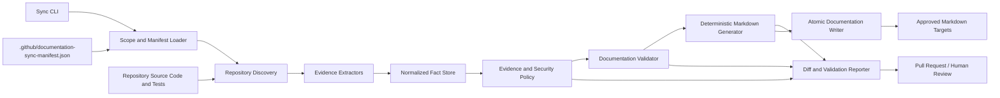
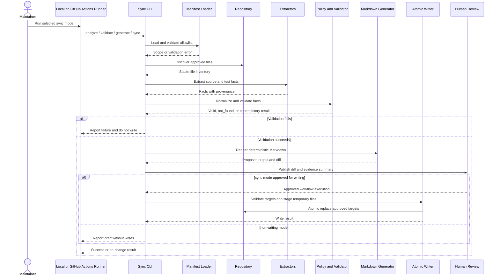
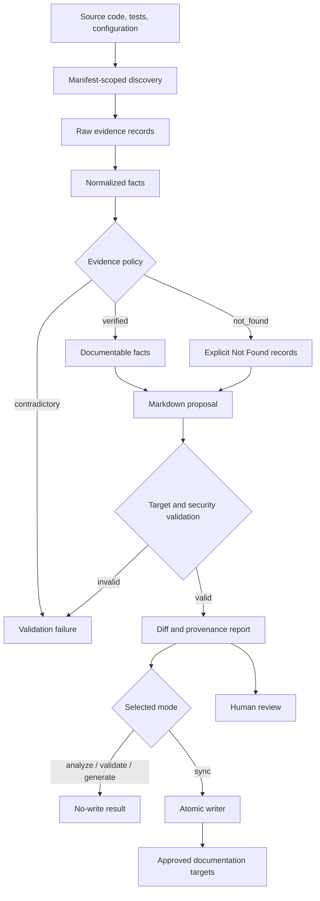

# Automated Documentation Sync Architecture

## 1. Architecture Context

This design implements the requirements in [agents/requirements.md](requirements.md) and the delivery sequence in [agents/planning.md](planning.md).

The solution is a repository-native documentation workflow. It reads approved source files, extracts evidence, validates documentation claims, generates deterministic Markdown, and optionally applies reviewed documentation updates. It does not change the Flask/SQLAlchemy application, the Astro/Tailwind application, or the existing runtime API.

Confluence and JIRA details are `Not Found` in the available workspace. Their integrations, credentials, schedules, and business metrics are therefore not part of this design.

## 2. Goals and Boundaries

### Goals

- Keep approved technical documentation aligned with source-code and test changes.
- Preserve provenance for every generated statement.
- Represent unavailable facts as `Not Found`.
- Fail closed on contradictions, missing provenance, unsafe paths, secrets, and failed writes.
- Make local and CI validation use the same implementation and result semantics.
- Keep generated changes reviewable by humans.

### Boundaries

- Inputs are restricted to the manifest source roots: `app/server`, `app/client/src`, and `app/client/e2e-tests`.
- Outputs are restricted to the manifest documentation targets.
- `content/**`, `docs/**`, and `app/client/README.md` remain excluded.
- Application runtime code and database state are read-only from the sync workflow.
- The exact CI trigger set and commit or pull-request write authority are `Not Found` pending clarification.

## 3. Component Architecture

### Component responsibilities

| Component | Responsibility | Key safeguards |
| --- | --- | --- |
| Sync CLI | Select `analyze`, `validate`, `generate`, or `sync` mode and return deterministic exit results. | No implicit write behavior; explicit mode required. |
| Scope and Manifest Loader | Load and validate the repository manifest and normalize paths. | Reject missing or malformed scope definitions. |
| Repository Discovery | Enumerate only configured source roots and documentation targets. | Repository-root containment, exclusion checks, stable ordering. |
| Evidence Extractors | Read routes, models, pages, tests, and configuration. | Read-only analysis; unsupported behavior is not inferred. |
| Normalized Fact Store | Represent facts with status, evidence, notes, and source files. | Preserve all provenance; distinguish missing from contradictory evidence. |
| Evidence and Security Policy | Enforce provenance, `Not Found`, contradiction, secret, and target rules. | Fail closed before generation or writes. |
| Documentation Validator | Compare current and proposed documentation with normalized facts. | Reject unsupported claims and scope violations. |
| Markdown Generator | Render deterministic approved documentation sections. | Stable ordering and no unproven assertions. |
| Atomic Documentation Writer | Apply validated output to approved targets. | Temporary same-filesystem writes, atomic replacement, cleanup. |
| Reporter | Emit facts, validation outcomes, changed targets, and review information. | Redact sensitive values; no secret values in logs. |
| CI Adapter | Run the same CLI and tests in GitHub Actions. | Least-privilege permissions; no runtime application changes. |

## 4. Sequence Diagram

## 5. Data Flow Diagram

### Data-flow rules

1. Source files are read only from manifest-approved roots.
2. Every normalized fact carries its evidence type and source-file list.
3. Missing evidence becomes `Not Found`; it is never filled by inference.
4. Contradiction stops the flow before generation is accepted.
5. Generation produces an in-memory proposal before any file is opened for replacement.
6. Writes occur only after target authorization and complete validation.
7. Reports contain references and decisions, not secrets or sensitive environment values.

## 6. API Design Boundary

The architecture deliberately avoids adding a runtime endpoint for documentation synchronization because the requirements specify a repository and CI workflow, not an application feature.

## 7. Storage Model

### Existing application storage

The existing application uses SQLite through Flask-SQLAlchemy. `DATABASE_PATH` selects the database path, defaulting to `app/server/dogshelter.db`. The sync workflow does not modify this database or depend on application startup.

The existing domain tables are:

| Table | Relevant fields | Role |
| --- | --- | --- |
| `breeds` | `id`, `name`, `description` | Breed reference data. |
| `dogs` | `id`, `name`, `breed_id`, `age`, `gender`, `description`, `status`, `intake_date`, `adoption_date` | Dog data and breed relationship. |

### Sync workflow storage

No new persistent database is required by the available requirements.

| Data | Storage | Lifetime | Source of truth |
| --- | --- | --- | --- |
| Manifest | `.github/documentation-sync-manifest.json` | Repository lifetime | Version-controlled configuration. |
| Extracted facts | In-memory structures or stdout/CI artifact | One run | Current source files and tests. |
| Generated proposal | In-memory content and review diff | One run until reviewed | Normalized facts. |
| Temporary output | Same-filesystem temporary files | Until atomic replacement or cleanup | Generated proposal. |
| Final docs | Approved Markdown files | Version-controlled | Human-approved repository content. |
| Audit result | CI logs or configured report artifact | Retention policy `Not Found` | CLI run result. |

Temporary files must be created with restrictive permissions where supported, placed in the target filesystem, and removed on both success and failure. No credentials, tokens, or environment values are persisted.

## 8. Security Design

### Scope and authorization

- Validate every input and output path against the repository root and manifest allowlist.
- Reject path traversal, absolute paths outside the repository, symlink escapes, and source-code write targets.
- Keep application source and database operations read-only.

### Least privilege

- Local and CI commands require read access to approved sources and write access only to approved documentation targets when sync mode is explicitly enabled.
- CI permissions shall be the minimum required for checks and review reporting. Exact permission settings are pending the unresolved write-authority decision.
- No Confluence or JIRA credentials are introduced without an approved integration requirement.

### Secret handling

- Do not print environment variables, credentials, connection strings, private keys, or tokens.
- Scan generated Markdown and report content for common secret patterns before output.
- Redact sensitive values in exception messages and logs.
- Keep database contents and runtime configuration outside generated documentation unless explicitly supported by safe evidence.

### Integrity and review

- Validate the complete proposal before atomic replacement.
- Require human review before merge.
- Preserve provenance so reviewers can challenge unsupported claims.
- Fail closed when evidence is contradictory or provenance is missing.

## 9. Error Handling Strategy

| Error class | Detection point | Behavior | Write allowed? |
| --- | --- | --- | --- |
| Missing or malformed manifest | Scope loading | Report configuration error and exit non-zero. | No |
| Missing required source | Discovery | Mark optional evidence `Not Found`; fail for required source. | No |
| Unsafe or excluded path | Discovery or writer | Reject path and report the attempted target. | No |
| Unsupported fact | Normalization | Emit `not_found` with notes and provenance context. | Yes, only as explicit `Not Found` output after validation |
| Contradictory evidence | Policy validation | Fail closed with conflicting sources. | No |
| Missing provenance | Documentation validation | Fail closed and identify the affected section. | No |
| Secret-like output | Security validation | Redact if safe; otherwise fail closed. | No unredacted output |
| Generation failure | Rendering | Return non-zero and preserve existing docs. | No |
| Atomic write failure | Writer | Clean temporary files, preserve existing targets, return non-zero. | No partial output |
| Unexpected internal error | Any stage | Emit a redacted error identifier and stack details only in protected CI diagnostics if allowed. | No |

### Exit result semantics

- Success/no change: validation passed and no target differs.
- Success/changed: validation passed and approved sync wrote complete target files.
- Validation failure: evidence, scope, security, or documentation contract failed; no writes occur.
- Operational failure: the workflow could not complete; existing targets remain unchanged.

### User-visible error requirements

Every failure report should include the stage, affected path or section, reason, evidence sources when safe, and recommended next action. It must not include secrets or unredacted environment values.

## 10. API and Integration Summary

| Interface | Type | Owner | Change in this solution |
| --- | --- | --- | --- |
| `/api/dogs` | Existing Flask GET endpoint | Application | Unchanged. |
| `/api/dogs/<int:id>` | Existing Flask GET endpoint | Application | Unchanged. |
| `/health` | Existing Flask GET endpoint | Application | Unchanged. |
| Sync CLI | New local/CI command | Documentation workflow | 
| Manifest | Versioned JSON contract | Repository governance | Existing allowlist and policy contract. |
| Confluence/JIRA | External systems | `Not Found` | No integration designed without source evidence and credentials. |

## 11. Deployment and Testing

- Package the sync implementation with repository tooling rather than the application runtime.
- Run focused unit tests for scope, evidence, extraction, policy, generation, writes, and reporting.
- Run existing backend and Playwright suites to verify no application regression.
- Run the same CLI modes locally and in GitHub Actions.
- Keep CI trigger and write authority decisions blocked until clarified.
