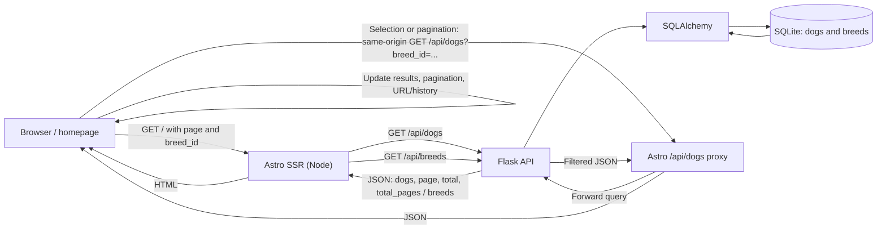

# Architecture — EPMCDMETST-70141

**Status:** Approved by the user on 2026-11-04 for Design Review. This approval does not authorize implementation, testing, API Design, or later SDLC phases.

## Architecture overview

The feature fits the existing application: an Astro/Node-rendered homepage, a Flask read API using SQLAlchemy, and the existing SQLite database. Reuse these components; no new service, table, persistence mechanism, or external integration is required by the approved requirements.

This architecture describes current source behavior and the proposed responsibility boundaries separately. Evidence is static source/configuration/test inspection only. The breed-filter source and test edits are uncommitted candidate changes; their presence does not establish runtime behavior or acceptance. No tests or builds were run for this architecture phase.

## Scope

### In scope

- Provide the breed list and filtered dog listing through the existing Flask API and Breed/Dog data.
- Render the homepage breed options and update the listing, URL, and pagination without a manual page reload.
- Keep filtered totals and the no-match experience consistent across API and UI.
- Add/update the relevant automated tests and documentation in their authorized later phases.

### Out of scope

As specified in approved requirements, multi-select, advanced search by age/gender, and saving filter preferences are excluded. Schema changes, new persistence contracts, caching, new services, and new observability infrastructure are also not required by the approved scope.

**Status: Out Of Scope** — These capabilities must not become implementation dependencies or block downstream phases.

## Components and boundaries

| Component | Responsibility in the proposed architecture | Current source evidence |
|---|---|---|
| Astro homepage (`app/client/src/pages/index.astro`) | Render the breed dropdown, dog list, and pagination; read/write `breed_id`; perform client-side selection and history updates. The API remains authoritative for filtering and totals. | Initial server render reads URL parameters and fetches dogs and breeds (lines 17–56); dropdown is at lines 85–99; client-side fetch, pagination, and `popstate` handling are at lines 174–426. |
| Astro same-origin dog API route (`app/client/src/pages/api/dogs.ts`) | Proxy browser listing requests to Flask, preserving the query string and response status. This avoids requiring a browser-to-Flask cross-origin request for interactive updates. | `GET` proxies `/api/dogs${url.search}`, forwards the response status/body, and returns 502 on fetch exceptions (lines 9–22). There is no corresponding `/api/breeds` proxy in the inspected source; the homepage fetches breeds during server rendering. |
| Flask API (`app/server/app.py`) | Own breed and dog query behavior, input handling, page bounds, response totals, and JSON response shape. `GET /api/breeds` lists available breed IDs/names; `GET /api/dogs` applies optional filters before counting and paging. | Routes and logic: `get_dogs` (lines 22–91), `get_breeds` (lines 93–98). |
| SQLAlchemy models and SQLite | Supply existing breed IDs/names and dog-to-breed relation; no new schema is proposed. | SQLite path configuration and `init_db` call: `app/server/app.py` lines 10–16. `Breed` has a unique name (`app/server/models/breed.py`, lines 7–10); `Dog.breed_id` references `breeds.id` (`app/server/models/dog.py`, lines 14–18). |
| Automated tests | Verify API behavior and homepage interactions using existing pytest/Playwright structure. | API tests: `app/server/test_app.py` lines 151–277. UI tests: `app/client/e2e-tests/search.spec.ts` lines 11–207; API integration tests: `app/client/e2e-tests/api-integration.spec.ts` lines 68–117. Tests were inspected, not run. |

### API/UI responsibility

The Flask API is the source of truth for breed data, filtering, and filtered `total`/`total_pages`. The homepage owns the interaction and presentation: it serializes the selected integer ID as `breed_id`, resets selection changes to page 1, retains the selection in pagination URLs, and renders an empty state when the API returns no dogs. API contract details beyond these requirements remain for the later API Design phase.

The approved filter contract requires integer `breed_id` only; no breed-name alias is required. Existing `breed` and `category` query handling is present in `app/server/app.py` and the homepage. Preserve those existing behaviors unless separately authorized, but do not depend on them to meet this feature. A changed dropdown selection should use `breed_id`; stale legacy query parameters must not accidentally narrow that selection.

## Data flow

1. A browser requests `/`. Astro reads `page`, `name`, and `breed_id`, then server-side fetches `/api/dogs` and `/api/breeds` from the Flask service using `API_SERVER_URL`.
2. Flask validates the query, applies the breed filter and any existing filters to the SQLAlchemy query, counts the filtered result, and retrieves the requested page from SQLite. The breed-list route returns IDs and names ordered by name.
3. Astro renders the controls, dog cards, and pagination into the page.
4. On a breed change, browser code requests the first page from the same-origin `/api/dogs` route with `breed_id`; Astro forwards the query to Flask. The browser replaces the list and pagination, then updates browser history and the URL without a full reload.
5. Pagination requests retain the selected `breed_id`. Browser back/forward reads the URL and re-fetches the corresponding page.

## Decisions and constraints

| ID | Decision | Basis / status |
|---|---|---|
| ADR-01 | Use the integer `breed_id` URL and API filter as the only required breed-filter contract; do not require a name alias. | Approved user decision in `requirements.md` OI-01 and FR-02. |
| ADR-02 | Reuse Flask, SQLAlchemy, SQLite, Astro, and the existing same-origin proxy; add no new runtime components. | Existing source and repository stack guidance; `copilot-instructions.md` lines 470–477 and `README.md` lines 84–90, 103–135. |
| ADR-03 | Apply the breed filter before computing count and pagination; leave unfiltered listing available when no breed is selected. | Approved requirements FR-03/FR-09; current `get_dogs` applies filters before `query.count()` (lines 53–75). |
| ADR-04 | Reset to page 1 on breed selection; preserve `breed_id` across pagination and history navigation. | Approved FR-05/FR-06; current homepage handlers at `index.astro` lines 335–426. |
| ADR-05 | Keep exact “All Breeds” as the required visible label. | Jira AC-01 as recorded in `intake-summary.md`; current source and current E2E test use “All” instead. This is a required acceptance discrepancy, not an architecture decision to change scope. |
| ADR-06 | Use the existing no-match behavior: API reports at least one logical page for zero results, while UI hides pagination unless `total_pages > 1`. | Current `app.py` lines 84–91 and `index.astro` lines 133–134, 280–283; permitted by approved AC-05. |

## Security design

- Keep these read-only GET paths limited to the approved listing data; the inspected handlers do not add authentication. Status: Not Found / Notes: The approved story defines no authorization model or access-control requirement; do not invent one for this feature. / Evidence: Not Found in `requirements.md` FR-01–FR-09 and AC-01–AC-07.
- Preserve server-side validation: `breed_id` must parse as an integer, name/breed text is limited to 100 characters, and page size is bounded to 1–100 (`app/server/app.py` lines 19–48). ORM filters are used to query by ID/name (`app/server/app.py` lines 53–75).
- Preserve HTML escaping in client-generated dog cards (`index.astro` lines 245–266) and Astro-rendered dog content (`app/client/src/components/DogList.astro` lines 10–39).
- The browser uses a same-origin route for interactive dog requests; the server-side Astro fetches call Flask using `API_SERVER_URL`. Do not expose credentials in URLs or client code. No credentials are required by the inspected feature path.
- The proxy's exception response currently includes the caught exception message (`app/client/src/pages/api/dogs.ts` lines 17–22). Avoid exposing internal details if this route is deployed beyond local development; assess response redaction in the authorized implementation/security review rather than expanding this architecture scope.
- `docs/secret-management-plan.md`: **Status: Not Found** / **Notes:** the referenced repository plan is absent from the inspected `docs/` tree; this feature has no credential requirement in inspected source. / **Evidence: Not Found**.

## Scalability and performance

The implementation reuses a relational filter on `Breed.id`, computes count after filters, and applies offset/limit pagination. The homepage currently requests six dogs per page; the API clamps page size to at most 100. The breed list is queried in name order and fetched during homepage server rendering. No quantitative latency/throughput target, index strategy, benchmark, or caching requirement is specified or evidenced.

**Status: Future Consideration** — Consider query/index or caching changes only if measured data demonstrates a need; no such change is required or a blocker for this story.

## Reliability and error handling

- Invalid `breed_id` values currently return 400; unknown IDs return an empty result; an out-of-range integer also returns an empty result (`app/server/app.py` lines 31–50; corresponding test definitions at `test_app.py` lines 165–197).
- The dog query count and page are derived from the same filtered query (`app/server/app.py` lines 53–75). Empty results use `total_pages: 1`; the UI hides pagination at one page.
- During interactive search, the homepage aborts a previous request and indicates pending/error status; stale pagination links are disabled while a request is pending (`index.astro` lines 309–383).
- The proxy returns upstream status/body, or 502 when its fetch throws (`api/dogs.ts` lines 9–22). Initial homepage fetches use `Promise.all`; a rejected fetch produces the page-level error state, while a non-OK breed response can leave the dropdown unpopulated (`index.astro` lines 38–57).
- No retry, timeout, health-check, or production recovery policy was found. These are not stated requirements and must not be added as blockers.

## Logging and observability

The inspected feature code exposes user-facing error/status messages, but contains no explicit structured application logging, metrics, tracing, or alerting for these requests. A quantitative observability target is absent.

Status: Not Found
Notes: No logging/metrics/tracing target or production monitoring configuration was identified in the approved requirements or inspected app/configuration files.
Evidence: Not Found in `requirements.md` NFR-01 / OI-04 or inspected app/configuration files.

Status: Future Consideration — Add operational telemetry under a separate approved scope if needed; it is not an implementation dependency for this story.

## Deployment constraints

- The Astro app is configured for server output with the standalone Node adapter (`app/client/astro.config.mjs`, lines 19–30). Flask defaults to `http://localhost:5100` when run directly (`app/server/app.py`, lines 131–134); the homepage and proxy both default `API_SERVER_URL` to that address (`index.astro`, line 5; `api/dogs.ts`, line 5).
- `DATABASE_PATH` selects the SQLite file and defaults to `app/server/dogshelter.db`; model initialization calls `db.create_all()` (`app/server/app.py`, lines 10–16; `app/server/models/__init__.py`, lines 7–13). A deployed Astro process must be configured with a reachable Flask `API_SERVER_URL`; a deployed Flask service must have a writable/appropriately persisted SQLite path. Localhost defaults describe local development, not cross-container production addressing.
- `app.run(debug=True, port=5100)` is the standalone development entry point. Production deployment must not expose Flask debug mode.
- Repository deployment documentation describes local two-service operation and states deployment is local/workshop-oriented (`README.md`, lines 235–245). No production topology, container/service definitions, TLS configuration, or deployment pipeline was found.

Status: Not Found
Notes: Production host, network policy, TLS termination, SQLite persistence/backup policy, and availability target are not specified.
Evidence: Not Found in `README.md` deployment summary (lines 235–245) or approved requirements.

## Requirement traceability

| Requirement | Architecture coverage | Evidence / gap |
|---|---|---|
| FR-01 / AC-01: sorted breed IDs and names | Flask `GET /api/breeds`; Astro fetches list for options. | `app.py` lines 93–98; `index.astro` lines 40–56, 89–95. Label discrepancy: source says “All”, not “All Breeds”. |
| FR-02 / AC-03: optional integer `breed_id` | Flask applies `Breed.id` filter; name alias is not required. | `app.py` lines 26–38, 66–68. Existing `breed`/`category` filters are legacy behavior, not part of this required contract. |
| FR-03 / AC-03: filtered totals and page totals | Count and page retrieval follow active filters. | `app.py` lines 53–91; test definitions `test_app.py` lines 266–277. |
| FR-04 / AC-01: dropdown from breed API | Astro fetches `breeds` and renders options. | `index.astro` lines 40–56, 85–99. Required literal differs in current source and test (`search.spec.ts` lines 11–16). |
| FR-05 / NFR-01 / AC-02: URL + refresh without manual reload | Client selection calls the same-origin API route and updates browser history. | `index.astro` lines 335–383, 403–405; proxy `api/dogs.ts` lines 9–22. |
| FR-06 / AC-04: preserve filter and reset page | Pagination URL builder carries `breed_id`; breed change requests page 1. | `index.astro` lines 29–36, 233–240, 403–405; test definitions `search.spec.ts` lines 52–59, 93–132. |
| FR-07 / AC-05: empty state and pagination behavior | API returns empty list and one page; homepage renders empty state and suppresses pagination. | `app.py` lines 84–91; `index.astro` lines 7–8, 131–134; `DogList.astro` lines 13–19. |
| FR-08 / AC-07: docs and automated tests | Existing backend and Playwright test structures cover this behavior; documentation/test delivery remains a later authorized phase. | `test_app.py` lines 151–277; `search.spec.ts` lines 11–207; `api-integration.spec.ts` lines 68–117. Not run. |
| FR-09 / AC-06: unfiltered listing retained | No `breed_id` means no breed-ID predicate; default page listing remains. | `app.py` lines 53–75; `index.astro` lines 17–25. |

## Risks and open decisions

| ID | Risk / open item | Handling |
|---|---|---|
| R-01 | Required “All Breeds” label conflicts with current homepage and E2E fixture, which say “All”. | Resolve in the authorized implementation/acceptance phase; do not silently treat candidate tests as the requirement. |
| R-02 | Existing `breed`/`category` URL compatibility can be carried alongside a newly selected `breed_id`; a stale alias may further restrict results. | Verify this interaction in later authorized testing. Removing unrelated legacy support is not required by the approved story. |
| R-03 | `app/server/app.py`, `app/server/test_app.py`, `app/client/e2e-tests/api-integration.spec.ts`, and `app/client/e2e-tests/search.spec.ts` are modified and uncommitted; intake records the branch is for another Jira. | Preserve all existing working-tree changes; do not infer validation or approval. |
| R-04 | Performance, accessibility, browser support, reliability, and availability targets are absent. | Status: Not Found / Notes: Requirements define only the interaction-level no-full-reload constraint. / Evidence: `requirements.md` NFR-01 and OI-04. Do not invent targets. |
| R-05 | Production deployment topology and operational policies are undocumented. | Status: Not Found / Notes: README documents local/workshop deployment only. / Evidence: `README.md` lines 235–245. Not a blocker for the scoped local feature. |
| R-06 | Jira comments and linked Confluence context are unverified per approved intake. | Status: Not Found / Notes: Intake says these sources could not be verified. / Evidence: `intake-summary.md`, “Comments and Confluence context”. Preserve the limitation; do not claim those sources were checked. |

No new dependency or schema decision is required by the evidence reviewed. API contract detailing, design review, and all later phases remain gated and have not started.

## Evidence index

- Approved scope and decisions: `docs/EPMCDMETST-70141/requirements.md` (FR-01–FR-09, AC-01–AC-07, SRC-01–SRC-06, OI-01–OI-06) and `docs/EPMCDMETST-70141/intake-summary.md`.
- Architecture/workflow rules: `instructions/architecture-instructions.md`; `skills/architecture/SKILL.md`; `copilot-instructions.md` (architecture gate at lines 263–282, source-of-truth at 402–416, stack preservation at 470–477).
- Backend and persistence: `app/server/app.py`; `app/server/models/__init__.py`; `app/server/models/breed.py`; `app/server/models/dog.py`.
- UI and proxy: `app/client/src/pages/index.astro`; `app/client/src/pages/api/dogs.ts`; `app/client/src/components/DogList.astro`; `app/client/astro.config.mjs`.
- Test definitions: `app/server/test_app.py`; `app/client/e2e-tests/search.spec.ts`; `app/client/e2e-tests/api-integration.spec.ts`.
- Local stack and deployment evidence: `README.md` (quickstart at lines 84–135, tests at 201–233, local deployment at 235–245); `app/server/requirements.txt`; `app/client/package.json`.
- `.github/agents/architecture.md` describes an unrelated automated documentation-sync system and was not used as dog-listing architecture evidence.
