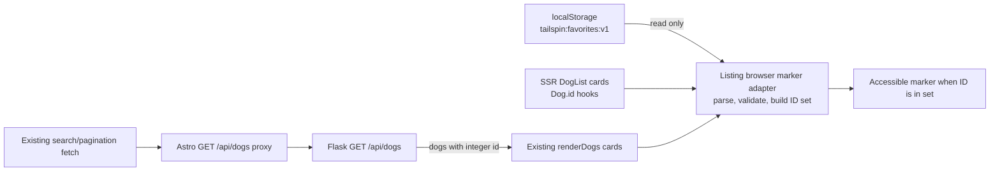

# Architecture: EPMCDMETST-70332

## Status and approval boundary

**Approved by the user on 2026-11-03 for progression to Design Review.**
This proposal was prepared by an explicitly authorized alternative agent
because the configured Architecture specialist was not callable. That
delegation deviation is recorded here; this is not represented as work by the
configured specialist.

This artifact covers only the Architecture phase. The user authorized Design
Review as the next phase; no later phase, implementation, testing, PR work, or
deployment is authorized by that decision. No code has been changed.

The approved requirements contract is localStorage key
`tailspin:favorites:v1`, whose value is a JSON array of integer `Dog.id`
values. OQ-01—how favorites are added or removed—remains unresolved. This
proposal defines a read-only marker and does not add or assume a writer,
control, or favorites management page.

## Goals and boundaries

- Mark each rendered dog card if and only if its ID is in the valid persisted
  favorite-ID set.
- Keep server-rendered initial cards and browser-rendered search/pagination
  results consistent with that set.
- Keep favorites in the browser; make no changes to the dogs API, database,
  backend, or deployment topology.
- Keep the presentation choice open while ensuring the marker has an
  accessible name or text and does not rely on color alone.

Out of scope: adding/removing favorites, server-side favorite state,
cross-device synchronization, a favorites management page, and implementation.

## Evidence: current behavior

These are verified repository observations, not proposed behavior:

| Area | Verified behavior | Evidence |
| --- | --- | --- |
| Initial listing | `index.astro` fetches the selected dog page and breeds during Astro rendering, then passes dogs to `DogList.astro`. The page size is six. | `app/client/src/pages/index.astro`: `API_SERVER_URL`, `PAGE_SIZE`, initial `Promise.all` fetch, `<DogList dogs={dogs}>`. |
| Initial cards | `DogList.astro` renders dog links and uses the numeric dog ID only in the details URL; it has no favorite marker or browser-storage access. | `app/client/src/components/DogList.astro`: `Dog` interface and `dogs.map`. |
| Client search/pagination | The inline browser script fetches `/api/dogs`, replaces `#dog-results` in `renderDogs`, and updates pagination without a full navigation. It does not read favorites. | `app/client/src/pages/index.astro`: `renderDogs`, `fetchAndRender`, `handlePaginationClick`. |
| Browser-to-service integration | The Astro `GET /api/dogs` route proxies the query string to Flask using `API_SERVER_URL`; it returns the upstream JSON and status. | `app/client/src/pages/api/dogs.ts`: `GET`; `app/client/src/pages/index.astro`: `API_BASE`. |
| Dogs API | Flask `GET /api/dogs` returns dog `id`, `name`, and `breed`, with page metadata; page size is bounded. The SQLAlchemy `Dog.id` is an integer primary key. | `app/server/app.py`: `get_dogs`; `app/server/models/dog.py`: `Dog.id`. |
| Tests | Playwright E2E tests cover initial cards, page-two results, filtering, and client-side search. The configured browser project is Chromium. No favorite-specific coverage exists. | `app/client/e2e-tests/homepage.spec.ts`; `search.spec.ts`; `app/client/playwright.config.ts`. |
| Runtime | Astro is server output with the Node standalone adapter. The client Dockerfile builds and starts the standalone server on port 4321. | `app/client/astro.config.mjs`; `app/client/Dockerfile`. |
| Existing favorites state | No existing favorite reader/writer was found in the repository search recorded in intake. Current listing/API source also contains no favorite behavior. | `docs/EPMCDMETST-70332/intake-summary.md`; sources above. |

## Proposed component boundaries

| Component | Responsibility in the proposed design | Boundary |
| --- | --- | --- |
| `DogList.astro` markup | Give each initial card a stable dog-ID hook and a marker element that is hidden/absent unless marked. Preserve its existing card link and content. | Presentation only; it does not read or write localStorage. |
| Browser marker adapter in the listing page | Own the single contract reader and normalization rule. Apply marker state to initial server-rendered cards and to every result set created by `renderDogs`. Use the same ID-to-marker rule for both paths. | Browser-only; read-only; no API or database dependency. |
| Existing `renderDogs` and pagination flow | Render returned dogs, then apply the marker adapter to the resulting cards using the current persisted set. | Retains existing filtering, pagination, URL, and request behavior. |
| Existing `GET /api/dogs` proxy and Flask endpoint | Continue returning listing data unchanged. | No favorite query parameter, API response field, endpoint, or backend persistence is proposed. |

The exact icon, text, placement, and styling are intentionally not selected in
Architecture. Whichever presentation is later selected must expose a clear
accessible name/text (for example, “Favorited”) and must not rely on color
alone.

## Proposed data flow

On page startup, browser code reads the key and decorates the initial SSR cards;
server rendering does not attempt to access browser storage. On each client
result render, the same adapter obtains/uses the current normalized set and
decorates the new cards. Refresh naturally repeats the read from the same
browser origin. A card is marked only when its `Dog.id` is in the set. Missing
or invalid storage, or a storage read exception, produces an empty set and
does not block listing/search.

### Storage normalization

- Read exactly `tailspin:favorites:v1`; do not write, remove, or migrate it.
- Treat a missing value, malformed JSON, non-array JSON, or an array with no
  valid integer IDs as an empty set, as required by FR-04.
- For an array containing a mixture of valid and invalid entries, use only
  integer IDs; duplicates collapse naturally in a set. Use safe-integer
  validation in JavaScript to avoid precision loss.
- Keep values from localStorage out of generated HTML. Build/update marker DOM
  using static markup and text/attributes, not interpolated storage content.
- A localStorage exception is a non-fatal read failure and follows the empty
  set behavior.

## API, integration, and runtime design

There is no new API contract. The browser continues to obtain dog data through
the existing same-origin `/api/dogs` Astro proxy and Flask list endpoint. The
dog ID returned by that endpoint is the join key to the browser-local set.
Favorites are not sent to Flask, included in request URLs, or embedded into
server responses. This avoids changing pagination semantics and keeps
browser-origin storage private to that browser profile.

No new package, environment variable, database migration, server route,
network call, or deployment component is proposed. The existing
`API_SERVER_URL` remains the listing service integration setting. Since
localStorage is origin-scoped, seeded values must be written for the exact
origin under test; another origin, browser profile, or cleared/private session
may have an empty set.

## Security, privacy, and reliability

- The contract stores dog IDs only, not credentials or user-identifying data
  (NFR-02). It is browser-local, not an authentication or authorization
  mechanism.
- Treat localStorage as untrusted input. Parse and validate it, fail closed to
  an empty set on malformed values or access errors, and never inject its
  contents into HTML.
- Do not log, transmit, or add analytics events containing favorite IDs. No
  favorites telemetry is required for this client-only presentation.
- The reader is read-only. Adding/removing favorites remains OQ-01 and requires
  a separate explicit decision before a writer or interactive control is
  designed.
- No favorites API/backend dependency is added, so service outages continue
  to be handled by the existing listing error/search behavior; a storage
  failure does not prevent non-favorite listing use.

## Performance, scalability, maintainability, and observability

- Normalize the value once per listing render into a `Set`; membership checks
  are constant-time on average. Work is linear in the stored array plus the
  currently rendered cards (six on the initial page; client API pages may
  vary within the backend's existing limit).
- Do not fetch a separate favorites resource or change API/database load.
- Keep one reader/normalizer and one marker-application path shared by SSR
  cards and client-generated results to avoid pagination drift.
- No new telemetry is proposed, and favorite IDs must not appear in logs.
  **Status: Not Found. Notes:** No application observability/telemetry
  configuration was identified in the listing/runtime sources reviewed.
  **Evidence: Not Found.**

## Deployment constraints and missing evidence

The proposed change is browser-side and requires no deployment or
configuration changes. The inspected client runtime is the Astro Node
standalone container on port 4321, with the Flask API addressed through
`API_SERVER_URL`. LocalStorage works only within the browser origin that owns
the key; the server cannot read it during SSR.

**Status: Not Found. Notes:** A production hosting target, browser support
policy, and deployment pipeline were not identified in the inspected runtime
and repository configuration. No new deployment assumption is made.
**Evidence: Not Found.**

## Requirement traceability

| Requirement | Proposed architecture element | Verification to plan after approval |
| --- | --- | --- |
| FR-01; Jira AC 1–2 | Shared marker adapter matches each card's dog ID against the normalized set; non-members remain unmarked. | Seed one displayed ID and one non-displayed ID; assert marker presence only on the matching card. |
| FR-02; Jira AC 3 | Apply the same reader/marker rule to initial cards and each `renderDogs` result; refresh re-reads the same key. | Seed IDs on at least two pages; verify page 1, page 2, and refresh. |
| FR-03 | Read only `tailspin:favorites:v1` as a JSON array of integer `Dog.id` values. | Seed the exact key/value in Playwright before navigation. |
| FR-04 | Missing, malformed, non-array, empty/invalid values and read exceptions resolve to an empty set without blocking the listing. | Verify absent key, invalid JSON, non-array JSON, invalid entries, and storage-access failure. |
| NFR-01 | Marker includes accessible text/name and is not color-only. | Inspect the accessibility tree and the rendered marker on a favorite card. |
| NFR-02 | Browser storage contains IDs only; no server or analytics transmission. | Inspect storage, browser requests, and logs for the seeded IDs. |

## Proposed decisions and alternatives

These are proposals pending human approval, not decisions already authorized
for implementation:

| ID | Proposal | Rationale / constraint |
| --- | --- | --- |
| AD-01 | Keep favorite lookup in the browser listing; read the approved localStorage key and join by `Dog.id`. | Browser storage is unavailable to SSR and no backend favorite contract exists. |
| AD-02 | Reuse the listing page's existing client render lifecycle for initial cards and fetched pages. | Keeps the two current render paths consistent without a new service. |
| AD-03 | Add no writer, toggle, management page, API field, endpoint, or database state. | Preserves approved scope and unresolved OQ-01. |
| AD-04 | Represent favorite state with a text/name-accessible marker; leave exact visual treatment to later design. | Satisfies NFR-01 without prematurely selecting styling. |

Alternatives considered: server/API-side favorite lookup is incompatible with
the browser-only localStorage source and would unnecessarily transmit state;
per-card rescanning of the array duplicates work and normalization rules, so a
single normalized set is preferred. No architecture decision selects the
marker's exact icon or placement.

## Risks and open decisions

| ID | Risk / open decision | Response |
| --- | --- | --- |
| R-01 / OQ-01 | No existing writer or add/remove interaction is verified. | Keep this design read-only; request explicit approval before designing a writer/control. |
| R-02 | SSR markup cannot know localStorage; the marker is applied in the browser after the page markup exists. | Apply promptly on startup and test both SSR and client-render paths; review any visible transition in Design Review. |
| R-03 | Storage can be absent, malformed, inaccessible, or cleared. | Fail to an empty set and keep the listing usable; users may then see no markers. |
| R-04 | Initial SSR cards and `renderDogs` are separate rendering paths. | Share one marker adapter and verify IDs on multiple pages and refresh. |
| R-05 | The contract is origin/profile scoped and offers no synchronization. | Keep cross-device, cross-origin, and account synchronization out of scope. |
| R-06 | Jira does not prescribe icon, placement, or exact copy. | Defer presentation selection; require accessible, non-color-only output. |

## Handoff

The user explicitly approved this architecture on 2026-11-03 and authorized
Design Review as the next phase. OQ-01 remains unresolved. Design Review was
not completed in this run because the configured specialist was unavailable;
no API Design, planning, implementation, test execution, PR, or deployment
was started.
