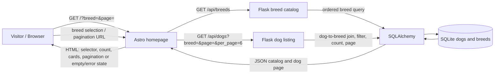

# Architecture: Search Dogs by Breed

## Architecture Overview

Breed search is implemented within the existing Astro frontend and Flask/SQLAlchemy API. The Astro homepage reads the optional `breed` and `page` URL parameters, requests the breed catalog and a page of dogs from the Flask API, and renders the selector, result count, dog cards, empty state, and pagination. The dog query joins dogs to breeds and applies the optional breed filter before counting and paging. The feature adds `GET /api/breeds` and a `breed` query parameter to `GET /api/dogs`; it adds no service or database schema.

This architecture documents the current implementation against the authoritative [requirements](requirements.md). Unspecified deployment topology, service-level targets, and operational policies are **Not Found**.

## Components

| Component | Responsibility | Verified implementation |
| --- | --- | --- |
| Visitor and browser | Select a breed, navigate pages, and view results. The selected filter is represented in the homepage URL. | `app/client/src/pages/index.astro` |
| Astro homepage | Reads `breed` and `page`; requests `/api/dogs` and `/api/breeds` concurrently; renders the breed selector and result states. The form resets selection changes to page 1, and pagination links retain the selected breed. | `app/client/src/pages/index.astro` |
| Dog list component | Displays dog cards linking to `/dog/{id}`, the result count, and a breed-specific or unfiltered empty message. | `app/client/src/components/DogList.astro` |
| Flask API | `GET /api/breeds` returns `{id, name}` catalog entries ordered by name. `GET /api/dogs` returns `dogs`, `page`, `per_page`, `total`, and `total_pages`; each dog entry contains `id`, `name`, and `breed`. | `app/server/app.py` |
| SQLAlchemy domain models | `Dog` rows refer to `Breed` by `breed_id`; the listing query joins the two models. | `app/server/models/dog.py`, `app/server/models/breed.py` |
| SQLite persistence | Stores the existing dog and breed data. The API configures SQLite using `DATABASE_PATH`, defaulting to `app/server/dogshelter.db`. | `app/server/app.py` |

## Data Flow

1. The browser requests the homepage, optionally including `breed` and `page`.
2. Astro reads those query parameters, defaults the page to 1, and requests six dogs per page. It calls `GET /api/dogs?page=...&per_page=6` and `GET /api/breeds` concurrently using `API_SERVER_URL` (default `http://localhost:5100`).
3. Flask loads the breed catalog in ascending name order. For dogs, it joins dogs to breeds, trims the supplied breed value, and applies case-insensitive full-name matching when the trimmed value is non-empty. It counts the filtered query, then applies offset and limit.
4. The API returns JSON. Astro renders the returned count and dogs. If there are no matches, the page renders a breed-specific empty message; with no filter, it renders the unfiltered empty message.
5. Choosing a breed submits the homepage form with page 1. Choosing “All breeds” omits the breed filter. Previous/next links preserve the selected breed in the URL.

### Mermaid component and data-flow diagram

## Security Design

- Breed and pagination values are received as query parameters. The backend trims breed text, clamps page to at least 1, and bounds `per_page` to 1–100 (the homepage requests 6).
- The breed condition is expressed through SQLAlchemy's query filter. `%`, `_`, and `\` are escaped before `ilike` with an explicit escape character, so these input characters are treated literally rather than as SQL `LIKE` wildcards. Unit tests verify the filter and escaping (`app/server/test_breed_search.py`).
- The listing and catalog routes are read-only. No authentication or authorization mechanism is present in these route implementations; broader access-control policy is **Not Found**.
- Transport security, deployment network boundaries, and production secret management are **Not Found** in the reviewed source.

## Scalability Design

- Results are paginated in the database query. The homepage requests 6 records per page; the API enforces a maximum of 100 and calculates the total after filtering.
- Breed lookup is a separate catalog request; both catalog and dog-page requests run concurrently in the homepage.
- The verified persistence configuration is SQLite. Indexing strategy, caching, horizontal scaling, expected traffic, and measurable latency or availability targets are **Not Found**. No additional scalability infrastructure is evidenced for this feature.

## Error Handling

- The homepage checks each fetch response's `ok` status and records a dog-data or breed-data error for unsuccessful responses. Fetch exceptions are caught and rendered in a visible error state; the page does not present a failed fetch as a successful empty result.
- A successful dog query with zero matches returns a normal response with an empty `dogs` array and `total: 0`; the frontend renders the appropriate empty state.
- The breed and dog listing route bodies do not define feature-specific handling for database/query exceptions. Their error mapping and user-facing behavior are **Not Found**.

## Logging and Observability

- No feature-specific logging, metrics, tracing, or alerting implementation is present in the reviewed listing routes or homepage. Logging configuration and operational observability policy are **Not Found**.
- A `GET /health` route is **Not Found** in the `main` base source reviewed for this branch. Health/readiness monitoring is therefore not described as an available check.

## Evidence

- Requirements and acceptance criteria: `docs/breed-search/requirements.md`.
- Route behavior and SQLite configuration: `app/server/app.py`.
- Dog/breed relationship: `app/server/models/dog.py`, `app/server/models/breed.py`.
- URL handling, API requests, form submission, pagination, and fetch errors: `app/client/src/pages/index.astro`.
- Result count, dog cards, detail links, and empty states: `app/client/src/components/DogList.astro`.
- API and wildcard-filter coverage: `app/server/test_breed_search.py`.
- Browser behavior coverage: `app/client/e2e-tests/homepage.spec.ts`.
