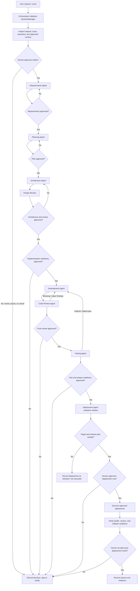

# PetWorkshop Multi-Agent Orchestration Example

This capstone example shows how an orchestrator can coordinate specialist
agents with `SessionManager` and `PromptCache`. It follows the sequential,
human-approved workflow described in
[`orchestrator.agent.md`](../.github/agents/orchestrator.agent.md).

> **Demonstration scope:** `SessionManager` and `PromptCache` are persistence
> helpers. They do not dispatch agents or enforce approvals. The code below
> illustrates how an orchestration host can wire them to agent and human-input
> adapters; it does not claim that `codemie-sdlc-orchestrator.js` currently
> performs this integration.

## Participants

| Participant | Role in the example |
| --- | --- |
| Orchestrator | Tracks progress, sends approved context to agents, requests human decisions, and routes failures back for correction. |
| `SessionManager` | Persists independent status, artifact, decision, risk, blocker, and dependency records for each agent in JSON. |
| `PromptCache` | Stores eligible prompt/response pairs under SHA-256 keys for exact-prompt reuse. |
| Requirements Agent | Turns the request and evidence into traceable requirements and acceptance criteria. |
| Planning Agent | Converts approved requirements into ordered, testable tasks. |
| Architecture Agent | Designs a solution from approved requirements and plan. |
| Development Agent | Implements the approved scope and reports changed files and validation evidence. |
| Code Review Agent | Reviews the implementation against requirements, design, and quality criteria. |
| Testing Agent | Runs applicable tests and reports evidence, defects, and release readiness. |
| Deployment Agent | Prepares deployment and verifies health/rollback evidence when a target is defined. |
| Human reviewer | Approves or rejects each required gate; approval is not inferred from agent output. |

## End-to-end flow



The orchestration guidance also calls for Jira/Confluence intake where
available. If a required source or deployment detail is unavailable, the
orchestrator records the gap and asks the human rather than inventing it.

## Step-by-step example

The artifact names below are illustrative; an agent must derive actual
requirements and paths from the supplied request and repository evidence.

| Step | Orchestrator action | Agent work and handoff | State/cache example |
| --- | --- | --- | --- |
| 1. Initialize | Inspect the issue and repository, and summarize scope. | No specialist agent proceeds until intake is approved. | `createSession("orchestrator")`; record intake evidence and the human decision. |
| 2. Requirements | After intake approval, provide the request, issue context, and repository evidence. | Requirements Agent produces a specification with stable requirement IDs, acceptance criteria, scope, assumptions, risks, and traceability. | Set stage to `requirements`; record the artifact; record approval only after the human approves. |
| 3. Planning | Supply approved requirements and repository conventions. | Planning Agent creates ordered tasks, dependencies, risk estimates, and validation commands mapped to requirements. | Set stage to `planning`; record plan reference and decision; wait for plan approval. |
| 4. Architecture | Supply approved requirements, plan, and repository evidence. | Architecture Agent describes components, data flow, contracts, risks, and alternatives. Design Review evaluates the proposal before implementation. | Record architecture and design-review references; record approval after the required human gate. |
| 5. Implementation readiness | Present approved scope, plan, architecture, and remaining risks to the human. | The Development Agent starts only after readiness approval. | Record the readiness decision and approved stage. |
| 6. Development | Give the Development Agent the approved artifacts, repository instructions, and tests. | Agent makes a focused change, adds applicable tests, and reports changed files, commands, outcomes, and remaining risks. | Record the implementation and test artifact references. Do not cache code-writing side effects as if they were replayable. |
| 7. Code review | Provide requirements, plan, architecture, diff, and developer report. | Code Review Agent reports severity-ranked findings and an explicit recommendation. Blocking or major findings return to Development for correction and another review. | Record review report and remediation decisions; require human approval of final review. |
| 8. Testing | Provide approved requirements, final implementation, and review result. | Testing Agent runs applicable checks and reports exact commands, results, failures, and gaps. Defects return to Development, then review and testing repeat. | Record test report; do not proceed on failed or unrun required checks. |
| 9. Deployment | Provide approved release evidence, target, release strategy, and rollback plan. | Deployment Agent prepares the release and, only when configured and approved, deploys and verifies health. | Record deployment plan and verification. If the target is unavailable, record a blocker and do not claim deployment. |
| 10. Close | Present evidence and unresolved risks for post-deployment review. | Human accepts or requests follow-up. | Record closure artifacts, decision, and any remaining blockers. |

## Example: state, approval, and cached analysis

This CommonJS sketch is intended to be adapted by an orchestration host. Run it
from the `workflow/` directory. `invokeAnalysisAgent` and
`requestHumanApproval` are host-provided adapters, not methods in this
repository. The agent adapter must return a text response; artifact creation
and validation remain explicit host responsibilities.

```js
const SessionManager = require("./session-manager");
const PromptCache = require("./prompt-cache");

const workflowId = "PET-123";
const sessions = new SessionManager(undefined, { jiraId: workflowId });
const cache = new PromptCache();

sessions.createSession("orchestrator");
sessions.createSession("requirements");

async function getAnalysis(agentName, stage, approvedInput, invokeAnalysisAgent) {
  // Include the approved input/version so changed context cannot reuse stale work.
  const prompt = [
    `workflow: ${workflowId}`,
    `stage: ${stage}`,
    `agent: ${agentName}`,
    "Use only the following approved input:",
    approvedInput,
  ].join("\n");

  const cachedResponse = cache.get(prompt);
  if (cachedResponse !== null) {
    return cachedResponse;
  }

  const response = await invokeAnalysisAgent(agentName, prompt);
  if (typeof response !== "string") {
    throw new TypeError(`${agentName} must return a string response.`);
  }
  cache.set(prompt, response);
  return response;
}

async function approveStage(stage, requestHumanApproval) {
  const approved = await requestHumanApproval(
    stage,
    sessions.loadSession("orchestrator")
  );
  if (!approved) {
    sessions.addDecision("orchestrator", { stage, outcome: "not approved" });
    return false;
  }

  sessions.addDecision("orchestrator", { stage, outcome: "approved" });
  return true;
}

async function prepareRequirements({ requestHumanApproval, invokeAnalysisAgent }) {
  sessions.updateStatus("requirements", "IN_PROGRESS");
  const approvedInput = "User request and verified repository evidence";
  const requirements = await getAnalysis(
    "Requirements Agent",
    "requirements",
    approvedInput,
    invokeAnalysisAgent
  );

  // The host validates and writes the artifact; the manager stores its reference.
  sessions.addArtifact("requirements", {
    name: "requirements",
    path: sessions.artifactPath("requirements"),
  });
  sessions.addDecision("requirements", {
    stage: "requirements",
    outcome: "artifact prepared",
  });

  if (!(await approveStage("requirements", requestHumanApproval))) {
    sessions.updateStatus("requirements", "BLOCKED");
    return { status: "paused", requirements };
  }

  sessions.updateStatus("requirements", "COMPLETED");
  return { status: "approved", requirements };
}
```

For Development and Deployment, invoke the agents directly through the host
adapter rather than replaying a cached response: their work can have side
effects. Never treat a cached analysis as human approval, test evidence, a
current code review, or proof of deployment. Do not cache secrets or sensitive
content.

## State and approval mapping

The example uses the actual `SessionManager` methods:

| Event | Persisted using |
| --- | --- |
| Begin or resume an agent session | `createSession(agentName)` / `resumeSession(agentName)` |
| Set an agent's workflow status | `updateStatus(agentName, status)` |
| Record an artifact reference | `addArtifact(agentName, artifact)` |
| Record a decision, risk, or blocker | `addDecision(agentName, record)`, `addRisk(agentName, record)`, `addBlocker(agentName, record)` |
| Save or inspect persisted state | `saveSession(agentName, data)`, `loadSession(agentName)`, `listSessions()` |

The manager records decisions but does not validate who approved them, enforce
gate order, or prevent a later agent from being invoked. Those controls belong
in the orchestration host. Likewise, `addArtifact` records a reference; it
does not create or validate the artifact file.

`PromptCache` can reuse an exact prompt/response pair. To reduce stale reuse,
include the agent, stage, and revision or content identity of approved inputs
in the prompt. Cache only deterministic, side-effect-free work where reuse is
allowed. Human approvals and mutable outputs must always be re-established for
the current workflow.

## Deployment boundary

The repository's deployment guidance states that an external hosting target,
deployment command, and environment details are not established. In the
current repository workflow, the Deployment Agent can prepare and validate
deployment evidence, but a real external deployment remains **blocked** until
the target and release details are provided. The diagram's deployment branch
is conditional and must not be presented as an already-configured capability.
